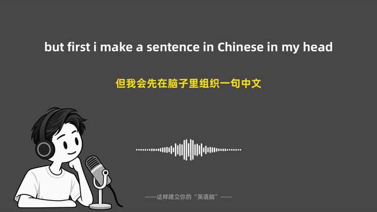
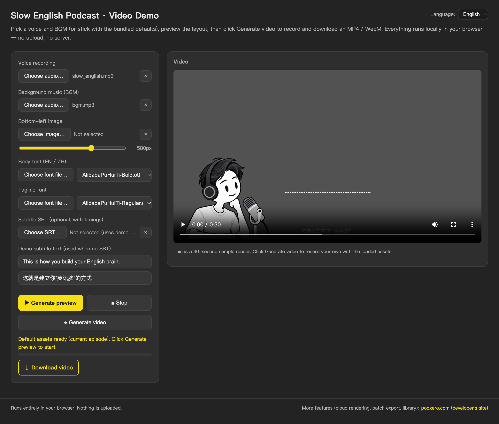
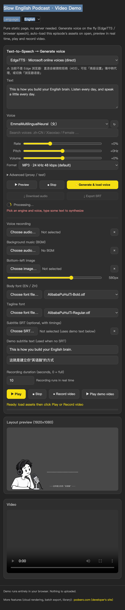

# 慢速英语播客视频 · Slow English Podcast

**用人声录音和英文字幕，自动翻译成中英双语字幕、混入 BGM，按 demo 版式渲染 1080p 视频——直接在浏览器里完成。**

> English version: [README.md](./README.md)

[](https://haituoworkspacebj.github.io/slow-english-podcast/)
[](#字体授权)
[](#国际化)
[](https://haituoworkspacebj.github.io/slow-english-podcast/)

---

## 🎬 演示

<a href="media/slow_english_demo.mp4"></a>

> 30 秒真实渲染片段：中英双语字幕、人声驱动声波、BGM 衬底。上面 GIF 是无声循环；点击图片查看有声 MP4，或用下方链接。

<a href="media/slow_english_demo.mp4">↓ 下载 / 播放 MP4（含声音）</a>

### 立即试用

**→ https://haituoworkspacebj.github.io/slow-english-podcast/**

打开后自动加载默认一集。替换素材 → 实时预览版式 → 点 **Generate video** 录制画布和混音 → 点下方出现的「↓ 下载视频」链接拿到文件。无上传、无服务器、无 TTS——人声和 BGM 都由用户本地提供（默认素材已预打包）。

### 📸 截图

| 桌面 | 手机 |
|---|---|
|  |  |

---

## 📑 目录

- [🚀 快速开始](#-快速开始)
- [✨ 特性](#-特性)
- [⚙️ 配置](#-配置)
- [📂 仓库结构](#-仓库结构)
- [🔧 工作原理](#-工作原理)
- [🌍 国际化](#-国际化)
- [🤝 参与贡献](#-参与贡献)
- [📄 字体授权](#-字体授权)

---

## 🚀 快速开始

### 🌐 浏览器 demo（免安装）

1. 打开 https://haituoworkspacebj.github.io/slow-english-podcast/
2. 点 **▶ Generate preview** 用自带的人声 + BGM 实时预览版式
3. 左侧文件选择器替换任一项素材：人声 / BGM / 小人图 / 字体 / SRT
4. 点 **● Generate video** 录制画布 + 混音；完成后下方进度条下面会出现「↓ 下载视频」链接，点击即可下载

完事。整个过程不上传任何东西，全部在浏览器里跑。

### 🐍 离线渲染（Python）

想要全分辨率、批量、或者 CI 用：

```bash
git clone https://github.com/haitaoworkspacebj/slow-english-podcast.git
cd slow-english-podcast
python3 -m pip install pillow numpy
python3 make_bilingual_srt.py                # 合并英文字幕时间轴 + 中文翻译
python3 render.py video                      # 整片 → output/slow_english.mp4
python3 render.py preview 78.3               # 单帧 → output/preview.png
python3 render.py video --start 70 --duration 20 -o output/test.mp4   # 片段
```

已在 Python 3.10+ 配 Pillow / numpy 测试通过。

---

## ✨ 特性

- 🎙 **声波只跟人声走** — 频谱条跟随说话者，不被 BGM 干扰。细节但消除"演示视频"最常见的破绽
- 📝 **双语字幕自动换行** — 0.15 秒淡入淡出，两行长度均衡，不留孤儿词
- 📂 **素材全部本地选择** — 人声、BGM、图片、字体、SRT 走文件选择器，不需要 API key，也没有远端调用
- ⏺ **浏览器录制 + 手动下载** — 画布 + 混音直接出 MP4（浏览器不支持则降级 WebM），录完后出现「下载视频」链接，点一下才下载，不自动下载也不上传
- ⚠️ **错误即时显示** — 解码失败、字体加载失败、录制器初始化错误都显示在红色错误框里，不会静默吞掉
- 📱 **响应式布局** — 手机单列、控件在上/舞台在下；1920×1080 canvas 在所有宽度下保持 16:9
- 🌐 **中英双语 UI** — 顶部语言切换；扩展第三语言只需改一个文件

---

## ⚙️ 配置

`render.py` 离线渲染器每个素材都支持命令行覆盖：

```bash
python3 render.py video \
  --voice   assets/voice.mp3 \
  --bgm     assets/bgm.mp3        # 或 "none"
  --srt     subtitles/bilingual.srt \
  --podcaster assets/Podcaster.webp \
  --font    fonts/AlibabaPuHuiTi-Bold.otf \
  --font-tag fonts/AlibabaPuHuiTi-Regular.otf \
  --tagline "——这样建立你的英语脑——"
```

浏览器 demo 通过文件选择按钮逐项替换素材，无需配置文件。

---

## 📂 仓库结构

| 路径 | 用途 |
|---|---|
| `web/` | 浏览器 demo 源码（HTML、CSS、JS、i18n） |
| `dist/` | 构建产物静态资源——发布到 GitHub Pages |
| `media/` | README 里用的样片和截图 |
| `assets/` | 样片素材：人声、BGM、小人图、源 SRT |
| `fonts/` | 正文字体 / 标语字体（阿里巴巴普惠体、Montserrat） |
| `subtitles/` | 双语 SRT + 中文翻译源文件 |
| `template/` | 版式参考 PNG |
| `render.py` | 离线渲染器（Python + Pillow + numpy） |
| `make_bilingual_srt.py` | 把英文字幕时间轴与中文翻译合并 |

---

## 🔧 工作原理

- **声波在人声加载时预分析**——`S.levels` 一次性算好。播放时画布直接查表，BGM 在 audio graph 里跑，跟声波无关
- `render.py` 离线渲染和 `web/` 浏览器 demo 共用同一套版式常量，预览与成片完全一致
- 所有默认素材（图片、字体、人声、BGM、SRT）都已打包到 `dist/` 根目录，GitHub Pages 直接可用
- 浏览器 demo 用 `MediaRecorder` 直接录画布和混音，没有上传服务端

更多细节见 [`.claude/skills/slow-english-podcast/SKILL.md`](.claude/skills/slow-english-podcast/SKILL.md)——这是 Claude Code 在这个项目里用的工作手册。

---

## 🛰 开发者网站（后台功能更全）

**→ https://www.podxero.com/**

本项目也在开发者的自有网站 [podxero.com](https://www.podxero.com/) 上线，那里提供更多后台能力：**云端渲染队列、批量导出、长视频流水线、素材库管理**。需要全功能版本请访问 [podxero.com](https://www.podxero.com/)。

> GitHub 仓库和 `haituoworkspacebj.github.io` 上的 demo 仅作展示。浏览器里录的视频默认留在本地，不会上传。

---

## 🌍 国际化

浏览器 demo 完整支持双语。`web/i18n.js` 收录 `en` + `zh` 字典；`web/index.html` 上每个可见文字都接 `data-i18n` 属性，运行时状态走 `I18N.t(key, …args)`。顶部切换器记忆在 `localStorage`，刷新保留。

**新增语言**（比如日语）只要三步：

1. 在 `web/i18n.js` 的 `STRINGS` 加一列 `ja`，按 `en` 的形状对齐
2. 在 `web/index.html` 的 `#langSwitch` 下拉里加 `<option value="ja">日本語</option>`
3. （可选）在 `current` 初始化块里加 navigator-language 兜底

重新压缩 `dist/i18n.js` 和 `dist/index.html`、重新部署即可，其他文件不用动。

---

## 🤝 参与贡献

欢迎提 Issue 和小补丁。除错别字以外的改动，请先开个 Issue 对齐方案。`render.py` 离线渲染和 `web/` 浏览器 demo **必须保持版式常量同步**——任何对条形高度、字幕位置、淡入淡出时长的改动都要同步两路，并以 `template/demo.png` 作为参照。

## ⭐ 觉得有用？点个 ⭐

如果这个项目帮你省了时间，或者启发了什么新点子——GitHub 上点个 ⭐ 就能让更多人发现它，也让我更有动力继续投入。

[**→ Star haituoworkspacebj/slow-english-podcast**](https://github.com/haituoworkspacebj/slow-english-podcast)

---

## 📄 字体授权

`fonts/AlibabaPuHuiTi-*.otf` 阿里巴巴普惠体可免费商用。**不要用 PingFang** 做最终视频字体——它是 macOS 系统字体，商用授权不明确。